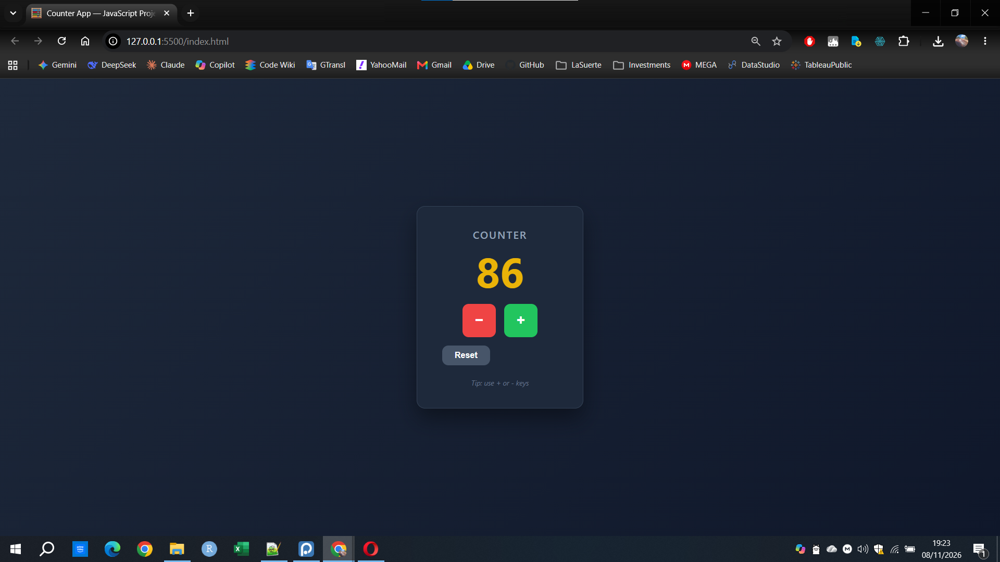

# 🧮 Counter App — JavaScript Project

A simple yet fully functional web application that simulates a counter. The user can increase or decrease the value using the **+** and **−** buttons. The entire user interface is generated dynamically via JavaScript.



## 🔗 Live Demo

👉 **[Try the application here](https://GG-script-code.github.io/counter-app/)**

---

## 📖 Description

When the user opens the page, the counter starts at `0` (or at the last saved value). Two buttons allow the user to increment or decrement the counter. The entire interface — including the title, the value display, and the buttons — is created dynamically using `document.createElement()` and `append()`. There is no hardcoded UI in the `index.html` file, as strictly requested by the project requirements.

The counter value is persisted using the **Web Storage API** (`localStorage`), meaning the value will be restored even if the user refreshes or closes the browser.

## ✨ Features

- **Increment / Decrement**: Increase or decrease the counter by 1 with the `+` and `−` buttons.
- **Dynamic UI**: 100% of the DOM elements are created via JavaScript (`document.createElement`, `append`).
- **Minimum Limit**: The counter cannot go below `0`. If the user tries, a visual error feedback is shown.
- **Reset Button**: Quickly set the counter back to zero (extra feature).
- **Persistence**: The value is saved in `localStorage` and survives page reloads.
- **Accessibility**: Includes `aria-live` and `aria-label` attributes for screen readers.
- **Responsive & Modern Design**: Built with Flexbox and CSS transitions.

## 🛠️ Technologies Used

- **HTML5**: Minimal skeleton (only a `<main id="app">` container).
- **CSS3**: Flexbox, transitions, custom properties, responsive layout.
- **JavaScript (ES6+)**: 
  - Variables (`let`, `const`), functions, and arrow functions.
  - **DOM Manipulation**: `createElement`, `append`, `textContent`, `classList`.
  - **Events**: `addEventListener`, `DOMContentLoaded`, and **Event Delegation** pattern.
  - **Web Storage API**: `localStorage` for data persistence.
  - **Timing API**: `setTimeout` for the visual feedback animation.

> **No libraries or frameworks** (no jQuery, React, Vue, Angular) were used. The project is built entirely with pure JavaScript.

## 📁 Project Structure

```text
counter-app/
├── index.html          # Minimal HTML skeleton
├── css/
│   └── style.css       # Styling and layout
├── js/
│   ├── counter.js      # Core logic (state, operations, storage)
│   ├── ui.js           # Dynamic DOM creation and event wiring
│   └── main.js         # Entry point (connects UI and Counter)
├── img/
│   ├── favicon.ico     # Browser tab icon
│   └── screenshot.png  # App screenshot for the README
└── README.md
```

## 🚀 How to Run Locally

1. Clone the repository:
```bash
   git clone https://github.com/GG-script-code/counter-app.git
```
